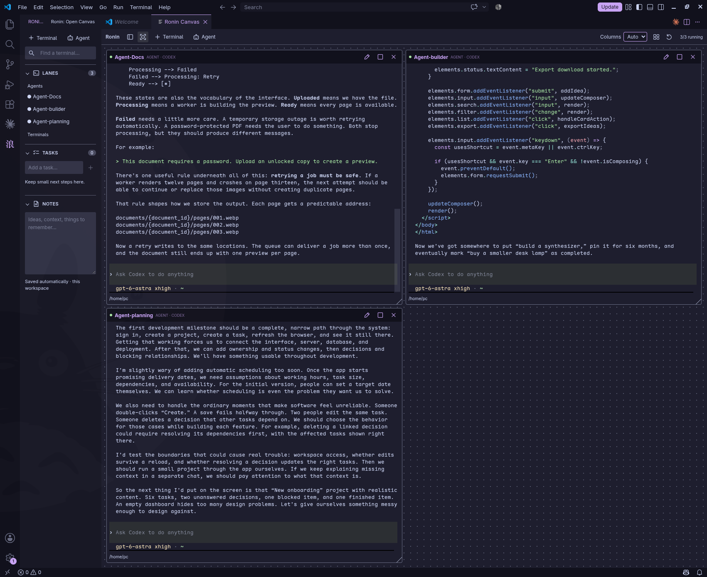

# Ronin Canvas

**Run persistent terminals and AI coding agents in movable panels inside VS Code.**

Ronin Canvas puts your shells in the editor area so you can watch several agents, a development server, and ordinary terminal work at once. Each panel is a real shell with its own working directory and optional launch command. Your Explorer, editors, and Git tools stay available alongside the canvas.



## Highlights

- Move and resize panels freely, arrange them in columns, or fit them automatically to the available space. Ronin saves each workspace's layout and terminal setup.
- Keep shells running when you close the canvas or VS Code. Ronin reconnects to the same processes and scrollback when you return.
- Run your own coding agent CLIs in separate panels. **Start** opens the shell; **Run command** launches that panel's saved command. The shell remains open after the command exits.
- Refresh one blank or stale panel without restarting its process. The refresh button asks the program to redraw and rebuilds the panel's display.
- Use the sidebar to jump between panels and keep workspace notes and tasks. The installed Ronin version appears at the bottom of the sidebar.
- Follow your VS Code theme and terminal color settings. Set `ronin.selectionStyle` to `theme` if you prefer VS Code's selection transparency over Ronin's solid highlight.
- Ctrl-click a file path in terminal output to preview it over the canvas. Wrapped paths are supported. Ctrl-Shift-click opens an inactive tab in the same editor group, leaving the canvas and its layout visible. Ctrl-click web links to open them in your browser.

File previews support text and common image formats (PNG, JPEG, GIF, WebP, AVIF, BMP, ICO, SVG). For images, scroll to zoom around the pointer and drag to pan. Images up to 10 MB can be previewed directly.

These features describe the current source on `main`. Published installers may lag behind it.

## Install

1. Download the `.vsix` for your platform from the [latest published release](https://github.com/Tech0001/ronin-vscode/releases/latest).
2. In VS Code, open the Command Palette and run **Extensions: Install from VSIX…**. Select the downloaded file and reload VS Code if prompted.
3. Open a trusted workspace, select **Ronin** in the sidebar, and click **Open Canvas**. Add a terminal or agent panel and press **Start**.

You can also run **Ronin: Open Canvas** from the Command Palette. Install and sign in to any agent CLI you want to use separately. The `.vsix` includes Ronin's native terminal components; end users do not need build tools.

Ronin targets Linux x64 and macOS on Apple Silicon or Intel. The macOS port has been tested on Apple Silicon; Intel still needs validation on an Intel Mac. Windows is not supported.

Closing VS Code leaves running programs alive. Use **Ronin: Stop Background Terminals** to end them intentionally. Sessions do not survive a machine reboot.

## Build from source

On macOS, install Node.js/npm and the Xcode Command Line Tools (`xcode-select --install`). Use an arm64 Node.js build on Apple Silicon or x64 on Intel. On Linux x64, install Node.js/npm, Python 3, Make, a C++ compiler, and Docker.

```bash
git clone https://github.com/Tech0001/ronin-vscode.git
cd ronin-vscode
npm ci
npm run package
```

The installer is written to `release/` with the platform and architecture in its name. Packaging uses the architecture of the Node.js process. Docker is used for Linux packaging; macOS builds use node-pty's native prebuild and compile a small helper with the Xcode tools.

Run `npm test` for unit tests and `npm run test:terminals` for live terminal tests covering persistence, reconnection, resizing, and interrupts.

### Updating an older installation

If your background terminal service was started by a version older than 0.5.11, a VS Code reload alone does not replace that service. After your agents finish, run **Ronin: Restart Background Terminal Service** once to get the mouse-scrolling fix. That command stops every running Ronin terminal and clears its scrollback; saved panel names, commands, and layouts remain.

## License

[MIT](LICENSE)
